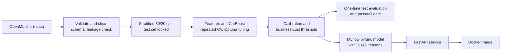

# Telecom Customer Churn Prediction

[](https://github.com/Hizafa-Nadeem/TelecomChurnPrediction/actions/workflows/ci.yml)


An end-to-end machine learning project: it predicts which telecom customers are likely to churn and tells a retention team who to contact and why. It covers data validation, honest evaluation, calibration, a business-cost decision threshold, explanations, an MLflow model package, a REST API, a Docker image and a load test, all runnable on a laptop.

The data is the public Orange/BigML churn set (OpenML ID 40701): 5,000 customers, 19 predictors, 14.1% churn. Its origin is loosely documented and it is probably partly simulated, so the results show the method, not real-world performance (see [Limitations](#limitations)).

## Results

Evaluated once on a held-out test set (1,000 customers, 141 churners). The pass criteria were committed before the test set was read ([`reports/final_evaluation.md`](reports/final_evaluation.md)).

| Metric | Result | 95% interval | Target |
|---|---|---|---|
| PR-AUC (primary) | **0.900** | 0.854 - 0.941 | at least 0.85 |
| ROC-AUC | **0.921** | 0.881 - 0.956 | at least 0.92 (thin margin) |
| Recall at the chosen threshold | **0.858** | 0.799 - 0.912 | at least 0.75 |
| Precision at the chosen threshold | 0.992 | 0.973 - 1.000 | n/a |
| PR-AUC of a logistic regression baseline | 0.543 | n/a | must be beaten |

- The decision threshold (0.23) comes from a retention-value calculation, with stated assumptions: a saved customer stays 12 months, 30% of offers are accepted and an offer costs 50.
- Test results match the cross-validation estimates (PR-AUC 0.902), so tuning did not overfit.
- Boosting beats logistic regression by a wide margin; class weights and oversampling (SMOTE) gave no gain, so plain CatBoost is used ([`reports/baselines.md`](reports/baselines.md)).

## How it works



Each stage is a command (`make data`, `make split`, `make tune`, `make calibrate`, `make evaluate`, `make package`, ...) that reads files and writes files, with parameters in [`configs/params.yaml`](configs/params.yaml) and runs logged to MLflow. Every stage has a short report in [`reports/`](reports/).

## Try it

The model returns, for each customer, a calibrated churn probability, a yes/no decision (make a retention offer) and up to three reasons.

### Option A: run the prebuilt image

Releases are published to GitHub Container Registry (see the repository's Packages):

```bash
docker run -p 8000:8000 ghcr.io/hizafa-nadeem/telecomchurnprediction:latest
```

### Option B: build it from source

You need Git, Python 3.11 and GNU Make (Windows: `winget install --id ezwinports.make`). The trained model is not stored in git, so it is retrained from the committed tuned settings (about 15 minutes, mostly downloads):

```bash
git clone https://github.com/Hizafa-Nadeem/TelecomChurnPrediction.git
cd TelecomChurnPrediction
python -m venv .venv
cp .env.example .env            # PowerShell: copy .env.example .env
make setup
make quickstart                 # download data, split, retrain, register and export the model
make serve                      # API on http://127.0.0.1:8000
```

On Linux or macOS add `PYTHON=.venv/bin/python` to every `make` command (the Makefile defaults to the Windows path). For a container instead of `make serve`: `make docker-build` then `make docker-run`.

### Predict

Open **http://127.0.0.1:8000/docs** and try `POST /predict`, or:

```bash
curl -X POST http://127.0.0.1:8000/predict -H "Content-Type: application/json" -d @docs/sample_customer.json
```

```json
{"churn_probability": 1.0, "decision": 1,
 "reasons": ["total_charge=76.2", "number_customer_service_calls=5", "international_plan=1"]}
```

`POST /predict/batch` takes 1 to 1,000 customers. Requests are validated against the [data contract](docs/data_contract.md): out-of-range values, unknown codes, missing fields and extra fields (such as `phone_number`) are rejected with HTTP 422. More in [`docs/serving.md`](docs/serving.md).

## What is in the repository

| Path | Content |
|---|---|
| `src/churn/` | The pipeline: `data`, `validation`, `split`, `features`, `train`, `tune`, `calibrate`, `evaluate`, `gate`, `explain`, `reasons`, `pyfunc_model`, `package` |
| `api/` | FastAPI service and request schemas |
| `tests/` | 78 tests (unit, model checks, API, and a Locust load test in `tests/load/`) |
| `configs/` | All parameters (`params.yaml`) |
| `reports/` | Results of each stage: EDA, baselines, tuning, calibration, final evaluation, explainability, load test |
| `docs/` | Project spec, development strategy, data contract, serving guide |
| `Dockerfile` | Slim non-root API image (`mlflow-skinny`, no training libraries) |

## Engineering practices

- **Honest evaluation:** the test set is read once, by one module that refuses a second run; pass criteria are fixed in a commit before the run; results carry bootstrap intervals and a segment error analysis.
- **No leakage:** the identifier column is dropped, a schema and leakage check fails the run, and all fitting happens inside cross-validation folds.
- **Reproducible:** pinned requirements, fixed seeds, data and git hashes logged with every MLflow run. A fresh clone retrained in a Linux container reproduces the same calibration and gives identical predictions to the original model (maximum difference 0.000000 on 1,500 customers).
- **Tested and checked in CI:** `ruff`, `black`, `mypy` and `pytest` run on every pull request.
- **Documented decisions:** deviations from the original plan (plain CatBoost, 30 tuning trials, DVC dropped) are written down with their reasons in the reports and [`docs/project_status.md`](docs/project_status.md).

## Limitations

- **The dataset is old and probably partly simulated.** Precision near 1.0 at 86% recall is unlikely on real operator data, and the model separates churners more cleanly than real behaviour would.
- **The test set has 141 churners,** so the intervals are wide. The ROC-AUC result clears its 0.92 target by only 0.001.
- **The business numbers are assumptions** (customer lifetime, offer acceptance, offer cost); the data has no customer-value column.
- **Latency:** the API reaches p95 under 100 ms at light load (about 18 requests/s on a laptop) but not at 10 concurrent users ([`reports/load_test.md`](reports/load_test.md)).
- **Reasons show what raises a customer's risk, not what causes churn,** and should be read together with the probability. There are no protected attributes in the data, so a protected-group fairness audit was not possible.
- The data is a static snapshot, so there is no time-based split. A planned Azure deployment demo (v2) and monitoring and batch scoring (v3) are not built yet.

## Development

Built step by step from a written plan ([`docs/project_spec.md`](docs/project_spec.md), [`docs/development_strategy.md`](docs/development_strategy.md)), with one reviewed pull request per step. The design decisions are the author's, for example plain CatBoost instead of class weights, 30 tuning trials, dropping DVC, and an evaluation whose pass criteria were fixed before the test set was read. [Claude Code](https://claude.com/claude-code) was used as a coding assistant, which is visible in the commit history.

## License

[MIT](LICENSE). The dataset is the public OpenML churn dataset (ID 40701) and is downloaded at run time, not redistributed here.
