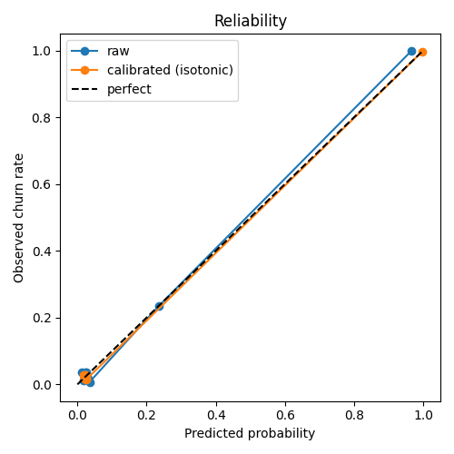
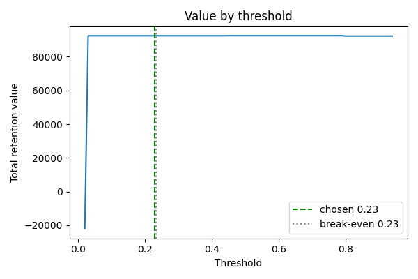

# Calibration and threshold (Step 9)

Code: `src/churn/calibrate.py` (`make calibrate`). Outputs: `reports/calibration/` (`calibration.json`, `reliability.png`, `threshold_value.png`) and, git-ignored, `models/final_model.joblib` and `models/calibrator.joblib`. One MLflow run named `calibration`.

## Method

- **Out-of-fold (OOF) probabilities.** The tuned CatBoost (`reports/tuning/best_params.json`) is fitted on the CV folds of the training split (5 folds x 3 repeats); every training row is predicted only by models that did not see it, and the three repeats are averaged. The test set is not read.
- **Calibrator choice.** Three options are compared on the OOF probabilities with a further 5-fold cross-fit (each row is calibrated by a fit that did not include it): none, sigmoid (Platt) and isotonic. The lowest Brier score wins.
- **Business value.** Flagging a customer costs `offer_cost`. A flagged churner is saved with probability `acceptance_rate` and is then worth their CLV, where CLV = monthly revenue (sum of the four `total_*_charge`) x `remaining_months`. The assumptions are in `params.yaml` (`business`): 12 months, 30% acceptance, offer cost 50. They are assumptions, not data: the dataset has no customer-value column.
- **Threshold.** Total realized value is computed on a grid of thresholds (0.02-0.94). The threshold is the maximizer; because the curve is flat (see below), the one chosen is the one closest to the break-even probability among those within 0.5% of the best value.
- **Final model.** CatBoost with the tuned parameters is fitted on the whole training split; the chosen calibrator, fitted on the OOF probabilities, is applied to its output.

## Results (training split, 4,000 customers, 566 churners)

| Calibrator | Brier | Log loss |
|---|---|---|
| none | 0.02046 | 0.10523 |
| sigmoid | 0.02009 | 0.10230 |
| **isotonic** | **0.01941** | **0.10022** |

Isotonic wins and is used. Calibration helps a little (Brier -5%) because the raw probabilities were already close to calibrated.

| Decision at threshold 0.23 | |
|---|---|
| Break-even probability (offer cost / (acceptance x mean CLV)) | 0.233 |
| Customers flagged | 12.25% |
| Precision | 99.6% |
| Recall | 86.2% (initial target: 75%) |
| Total retention value | 92,499 (23.1 per customer) |
| Best value on the grid | 92,549 (0.05% higher) |
| Flag everyone | -66,439 |
| Flag nobody | 0 |

 

## Read-out

- **The threshold barely matters.** Total value is 92,499-92,549 for every threshold from 0.05 to 0.75 (92,333 above 0.80). The calibrated probabilities are nearly two-valued: the reliability plot has only three clusters, at about 0.02, 0.23 and 0.97. A customer is either clearly flagged or clearly not, so the cost assumptions (months, acceptance, offer cost) shift the break-even point but change very little who is flagged.
- **What the model catches.** About 86% of churners (about 488 of 566) get a probability near 1 and almost none of the others do, which is why precision is 99.6%. The remaining 14% of churners (about 78) look like stayers and are not catchable with these features.
- **Overfitting of the threshold** is small: one parameter chosen on labelled training data, on a flat curve.

## Limits

- All figures are estimates on the training split, not final performance. The single test-set evaluation is Step 10.
- The dataset is old and probably partly simulated (see `docs/project_spec.md` section 2). Near-perfect precision at 86% recall is unlikely on real operator data, where the probabilities would be less two-valued and the threshold would matter more. Re-run this step on any new data.
- The calibrator is fitted on OOF predictions from models trained on 80% of the data and applied to a model trained on 100%; the final model may be slightly more confident than the calibrator expects.
- The business numbers (12 months, 30%, 50) are placeholders chosen by the project owner, not measured values.
