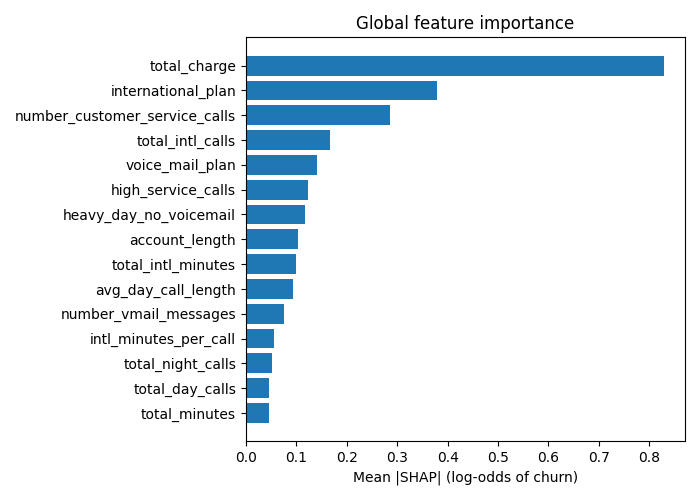
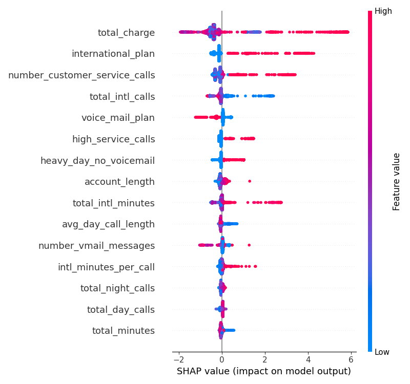

# Explainability (Step 11)

Code: `src/churn/explain.py` (`make explain`). Outputs in `reports/explainability/`: `global_importance.csv`, `shap_importance.png`, `shap_summary.png`, `example_reasons.csv`. One MLflow run named `explainability`.

## Method

- **SHAP values** come from CatBoost's exact TreeSHAP (`get_feature_importance(type="ShapValues")`) on the final tuned model, so the categorical columns need no special handling. For each customer the contributions plus a constant base value equal the model's raw score (log-odds of churn); a test checks this.
- **Global view:** computed on the training split (4,000 customers). The test split is not read.
- **Per-customer reasons:** `top_reasons(model, X, k=3)` returns `reason_1..3`, the features that push that customer's churn risk up the most, written as `feature=value` (for example `international_plan=1`). A feature is listed only if its contribution is at least 0.1 log-odds (about +10% on the odds of churn); customers with no clear driver get empty slots, so stayers are not given invented reasons. This function is what the served model (branch 11) calls, so the reasons come from the same code in training, the MLflow model and the API.

## Global importance

Mean absolute SHAP value (log-odds) over the training split:

| Feature | Mean abs SHAP |
|---|---|
| total_charge (sum of the four charges, a revenue and usage measure) | 0.829 |
| international_plan | 0.379 |
| number_customer_service_calls | 0.285 |
| total_intl_calls | 0.167 |
| voice_mail_plan | 0.141 |
| high_service_calls | 0.124 |
| heavy_day_no_voicemail | 0.117 |
| account_length | 0.104 |
| total_intl_minutes | 0.099 |
| avg_day_call_length | 0.093 |

## Read-out

- **The model's drivers match the EDA** (`reports/eda/findings.md`): heavy usage, the international plan and 4+ service calls raise risk; a voicemail plan and many voicemail messages lower it.
- **`total_charge` is the largest driver.** High values push risk up strongly (up to about +6 log-odds); this is the day-usage effect found in the EDA, amplified because `total_charge` sums all four periods. Its effect is not a straight line, so the plot shows both signs.
- **International plan** (about +2 to +4 when present) and **service calls** (about +1 to +3 at 4 or more) are the next strongest.
- **More international calls lower the risk**, while more international minutes raise it: a model effect worth knowing about, not a recommendation to act on.
- **`area_code` and `state`** are not among the leading features, in line with the EDA (no signal in `area_code`, weak and noisy `state`).

## Example reasons

Ten random training customers (`example_reasons.csv`): the customer with a 0.92 churn probability gets `international_plan=1`, `total_intl_minutes=14.4`, `avg_day_call_length=1.0`; most customers with probabilities of 1-5% get zero or one weak reason. A customer with 5 service calls but a 2.8% churn probability is correctly shown with weak or no reasons, because other features outweigh it.

## Limits

- SHAP explains what the model does, not what causes churn. Correlated features share the credit (for example `total_charge` and the usage minutes and calls), so single-feature rankings are approximate.
- `state` is an anonymous code and `account_length` has no stated unit, so reasons that name them cannot be interpreted.
- The 0.1 cutoff is a judgement call; a lower value lists more, weaker reasons.
- The reasons describe the training data's patterns; the dataset is probably partly simulated (see `docs/project_spec.md` section 2).
