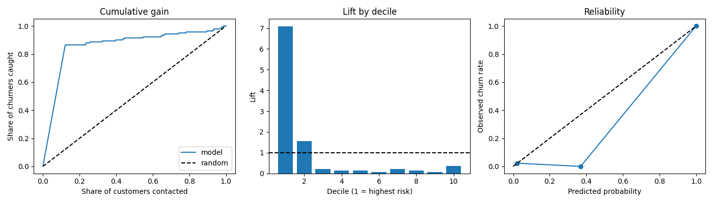

# Final evaluation on the test set (Step 10)

Code: `src/churn/evaluate.py` (`make evaluate`), `src/churn/gate.py` (`make gate`). Raw results: `reports/evaluation/test_evaluation.json`; figures: `reports/evaluation/evaluation.png`; MLflow run `final_evaluation`.

## Setup

- **One pass.** The test split (1,000 customers, 141 churners, 14.1%) was read once, by `evaluate.py`, after everything else was fixed: the tuned CatBoost fitted on the training split, the isotonic calibrator and the threshold 0.23 from `reports/calibration.md`. Nothing was re-fitted or re-picked on the test set, and `evaluate.py` refuses a second run.
- **Pass criteria fixed beforehand.** They were committed (`93241d5`) before any test-set code existed: PR-AUC >= 0.85 and ROC-AUC >= 0.92 (raw model score), recall >= 0.75 at the threshold, and a PR-AUC win over the logistic regression baseline.
- **Intervals.** 95% percentile bootstrap, 1,000 resamples of the test customers.
- **Business value** uses the assumptions in `params.yaml` (12 months, 30% acceptance, offer cost 50); they are assumptions, not data.

## Result against the criteria

| Criterion | Required | Test result | 95% interval | |
|---|---|---|---|---|
| PR-AUC (raw score) | >= 0.85 | **0.8999** | 0.854 - 0.941 | pass |
| ROC-AUC (raw score) | >= 0.92 | **0.9211** | 0.881 - 0.956 | pass, thin margin |
| Recall at threshold 0.23 | >= 0.75 | **0.8582** | 0.799 - 0.912 | pass |
| PR-AUC vs logistic regression | > 0.5427 | **0.8999** | gain +0.357 (0.284 - 0.436) | pass |

`make gate`: PASS.

**On the ROC-AUC margin.** The point estimate clears 0.92 by 0.001, and the interval reaches down to 0.88. With 141 churners the test set cannot show that the true ROC-AUC is above 0.92; it shows that the model meets the target within the noise. PR-AUC and recall have clear margins (recall's lower bound, 0.80, is above 0.75).

## Consistency with the training estimates

| | Cross-validation (training split) | Test set |
|---|---|---|
| PR-AUC | 0.9016 | 0.8999 |
| ROC-AUC | 0.9278 | 0.9211 |
| Recall at threshold | 0.862 | 0.858 |

The test results sit inside the CV spread, so tuning and threshold selection did not overfit the training folds.

## Decision at threshold 0.23

| | |
|---|---|
| Customers flagged | 12.2% (122 of 1,000) |
| True positives / false positives | 121 / 1 |
| False negatives / true negatives | 20 / 858 |
| Precision | 0.992 (0.973 - 1.000) |
| Recall | 0.858 (0.799 - 0.912) |
| F1 | 0.920 (0.885 - 0.952) |
| Recall at 90% precision (raw score) | 0.865 (0.806 - 0.919) |
| Lift in the top decile | 7.1 (6.1 - 8.4) |
| Retention value per customer | 22.7 (18.7 - 26.5) |

Calibrated probabilities: Brier 0.0197, log loss 0.124. Isotonic calibration creates tied scores, so PR-AUC on the calibrated output (0.8886) is a little below the raw score's 0.8999; ROC-AUC is the same (0.9205 vs 0.9211).

Baselines: dummy PR-AUC 0.141 (the churn rate); logistic regression PR-AUC 0.543 and ROC-AUC 0.872.

## Error analysis by segment

Recall and precision of the decision, with a 95% Wilson interval for recall (Fairlearn `MetricFrame`). There are no protected attributes in the data, so a protected-group fairness audit is not possible (documented limitation); these are segment checks only. State groups (10 highest and 10 lowest churn states) come from the training split.

| Segment | Level | Customers | Churners | Recall (95% CI) | Precision |
|---|---|---|---|---|---|
| International plan | no | 907 | 103 | 0.81 (0.72 - 0.87) | 0.99 |
| | yes | 93 | 38 | 1.00 (0.91 - 1.00) | 1.00 |
| Service calls | 0-1 | 550 | 58 | 0.84 (0.73 - 0.92) | 1.00 |
| | 2-3 | 369 | 41 | **0.73 (0.58 - 0.84)** | 1.00 |
| | 4+ | 81 | 42 | 1.00 (0.92 - 1.00) | 0.98 |
| Voicemail plan | no | 738 | 118 | 0.86 (0.79 - 0.91) | 1.00 |
| | yes | 262 | 23 | 0.83 (0.63 - 0.93) | 0.95 |
| Area code | 408 | 235 | 38 | 0.84 (0.70 - 0.93) | 1.00 |
| | 415 | 479 | 55 | 0.82 (0.70 - 0.90) | 1.00 |
| | 510 | 286 | 48 | 0.92 (0.80 - 0.97) | 0.98 |
| State group | high-churn | 211 | 36 | 0.81 (0.65 - 0.90) | 1.00 |
| | middle | 605 | 82 | 0.88 (0.79 - 0.93) | 1.00 |
| | low-churn | 184 | 23 | 0.87 (0.68 - 0.95) | 0.95 |

- The model catches every churner with an international plan or 4+ service calls, and misses most often among customers without those signals, mainly 2-3 service calls (recall 0.73) and no international plan (0.81). Those churners behave like stayers on the available features.
- No segment collapses, but most groups have fewer than 50 churners, so the intervals are wide and small differences between segments are not significant.

## Limits

- The test set has 141 churners; the intervals above show how much that limits what can be claimed.
- The dataset is old and probably partly simulated (`docs/project_spec.md` section 2). Precision near 1.0 at 86% recall is unlikely on real operator data; results show the method, not real-world performance.
- No temporal split is possible (static snapshot), and no protected attributes exist.
- The business value depends on assumed lifetime, acceptance rate and offer cost.
